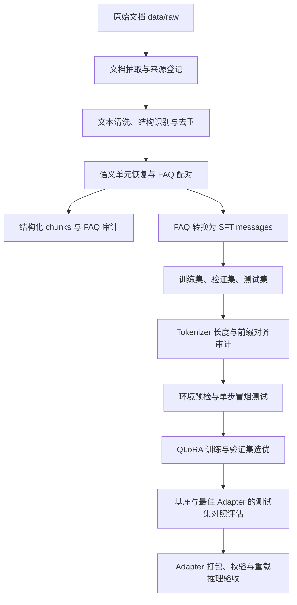

# 基于 Qwen3-8B 与 QLoRA 的党建知识微调项目

本项目面向基层党务知识问答，提供从原始文档处理、监督微调数据集构建，到 QLoRA 训练、独立测试集评估和 LoRA Adapter 打包的完整工程流程。项目以 `Qwen/Qwen3-8B` 为基础模型，采用 4-bit NF4 量化与 LoRA 参数高效微调，在保留来源追溯信息的基础上，将文档中已有的 FAQ 转换为对话式训练样本。

仓库已包含完整训练、评估和发布验收记录。已保存的实验结果显示：在 79 条保留测试样本上，微调模型的测试损失由 **1.9303** 降至 **1.2241**，下降约 **36.59%**；字符级 F1 和 ROUGE-L 均有提升。发布验收报告记录 `project_complete=true`。这些数据来自仓库内的历史运行产物，具体配置、评估口径和适用边界见下文。

## 1. 项目目标与范围

项目目标是建立可追溯、可审计的领域模型微调流程，用于基层党务 FAQ 的研究验证和辅助问答。主要交付内容包括：

- 文档抽取、清洗、结构恢复和 FAQ 配对程序。
- 具有稳定样本标识、来源信息和固定划分规则的 SFT 数据集。
- Tokenizer 审计、训练环境预检、单步冒烟测试与完整训练脚本。
- 基座模型与微调模型的测试集对照结果、逐条预测和质量审计记录。
- LoRA Adapter 发布包、模型卡、训练摘要、评估摘要及文件校验和。

当前工程以命令行脚本为使用入口，交付范围不包含 Web 界面、在线推理 API、RAG 检索服务或完整模型合并部署。数据处理阶段依据源文档恢复已有问答，不使用大模型合成新的问答内容。

## 2. 技术方案

### 2.1 处理流程



SFT 构建直接读取 `data/chunks/semantic_units.jsonl` 中的 FAQ 语义单元；`chunks.jsonl` 是同一阶段的结构化文本产物，不直接作为训练输入。训练使用 `train.jsonl` 更新参数，使用 `validation.jsonl` 选择最佳检查点，`test.jsonl` 保留用于最终对照评估。

### 2.2 模块与实现

| 模块 | 主要职责 | 实现位置 |
| --- | --- | --- |
| 文档抽取 | 按文件后缀选择解析器，输出统一记录、文件哈希及抽取清单 | `src/data_pipeline/extractor.py`、`extractors/` |
| 文本清洗 | Unicode 与空白规范化、结构识别、质量过滤、精确及 SimHash 去重 | `src/data_pipeline/cleaning/` |
| 语义处理 | 恢复源记录顺序、识别问题、配对答案、保留标题结构并分块 | `src/data_pipeline/chunking/` |
| 数据集构建 | FAQ 转换、样本校验、同问冲突剔除、确定性划分与泄漏检查 | `src/data_pipeline/sft/` |
| Tokenizer 审计 | 使用模型聊天模板检查长度、覆盖率、提示词前缀及回答监督区间 | `src/data_pipeline/tokenization/` |
| 模型训练 | 量化加载、LoRA 配置、训练检查、检查点选择及 Adapter 验证 | `src/data_pipeline/training/` |
| 评估与发布 | 计算测试指标、记录逐条预测、验证权重来源并生成发布包 | `training/phase5d.py`、`training/phase5e.py` 及对应脚本 |

训练后端包含 Hugging Face 和 Unsloth 两种实现，用于环境验证及后端对比；当前正式训练脚本采用 **Unsloth + TRL SFTTrainer**。训练目标为 `assistant_only_loss=True`，Unsloth 路径通过提示词与完整对话的 token 前缀对齐构造监督标签，并在运行中检查回答区域的 mask。

## 3. 目录结构

```text
.
├── README.md
├── requirements.txt                 # 文档处理与 Tokenizer 依赖
├── requirements-train.txt           # 训练通用依赖
├── src/data_pipeline/
│   ├── extractors/                  # 各格式解析器
│   ├── cleaning/                    # 清洗、结构识别与去重
│   ├── chunking/                    # 语义单元、FAQ 与分块
│   ├── sft/                         # SFT 样本与数据划分
│   ├── tokenization/                # Tokenizer 审计
│   ├── training/                    # 训练后端、评估与发布逻辑
│   └── utils.py                     # 公共读写与日志工具
├── scripts/                         # 命令行入口
├── tests/                           # 各阶段测试
├── docs/MODEL_CARD.md                # 模型说明与加载示例
├── data/
│   ├── raw/                         # 原始文档输入
│   ├── extracted/                   # 抽取记录与清单
│   ├── processed/                   # 清洗结果、拒绝记录与重复记录
│   ├── chunks/                      # 语义单元、分块与 FAQ 审计
│   ├── sft/                         # 全量样本及 train/validation/test
│   ├── tokenizer/                   # 逐样本 token 审计及汇总
│   └── training/                    # 训练、评估和发布验收报告
├── outputs/                         # 运行生成的检查点与 Adapter
│   ├── phase5c-b/                   # 正式训练检查点及 best_adapter
│   └── phase5e/release/              # 最终发布包
└── logs/                            # 运行日志
```

`outputs/`、`logs/` 和虚拟环境已配置为 Git 忽略项。克隆仓库可获得已提交的数据与报告；模型权重、训练检查点及发布包需另行准备或运行流程生成。

## 4. 数据说明

### 4.1 数据来源与规模

当前基线使用 `data/raw/基层党务（试用版）(1).docx`。各阶段保存的统计如下：

| 处理环节 | 数量 | 说明 |
| --- | ---: | --- |
| 抽取记录 | 5,523 | 从 1 份 DOCX 文档抽取 |
| 清洗后记录 | 5,433 | 剔除 4 条质量不合格记录、76 条精确重复和 10 条近重复 |
| 语义单元 | 1,400 | 包含 FAQ、标题及其他文本单元 |
| FAQ 配对 | 1,327 | 高置信度 1,318 条，中置信度 9 条 |
| 有效 SFT 样本 | 1,303 | 剔除 12 组同问不同答冲突，共 24 条 |
| 训练集 | 1,149 | 用于参数更新 |
| 验证集 | 75 | 用于训练期间评估和检查点选择 |
| 测试集 | 79 | 用于最终基座与微调模型对照 |

统计来源：[抽取清单](data/extracted/manifest.json)、[清洗报告](data/processed/quality_report.json)、[分块报告](data/chunks/chunk_report.json)和[数据集报告](data/sft/dataset_report.json)。

默认目标划分比例为 `90% / 5% / 5%`。程序按规范化问题生成分组键，并结合固定盐值 `qlora-sft-phase4-v1` 进行哈希分桶，因此实际条数不严格等于目标比例；相同问题保持在同一划分内。

### 4.2 输入格式

程序递归扫描输入目录，通过后缀识别文件类型，不依赖父目录名称。

| 格式 | 支持的后缀 | 解析方式 |
| --- | --- | --- |
| PDF | `.pdf` | PyMuPDF 文本抽取 |
| Word | `.docx` | python-docx |
| Markdown、纯文本 | `.md`、`.markdown`、`.txt`、`.log` | 文本读取 |
| HTML | `.html`、`.htm` | BeautifulSoup4 |
| Excel、CSV | `.xlsx`、`.xlsm`、`.csv` | openpyxl、标准库 CSV |
| JSON、JSONL | `.json`、`.jsonl` | 标准库 JSON |

当前未实现 `.doc`、PowerPoint、音视频及图片 OCR；疑似扫描版 PDF 会记录 `possible_scanned_pdf` 警告。原始输入文件在处理过程中保持只读。

### 4.3 样本结构与质量控制

每条 SFT 样本包含 `sample_id`、`messages` 和 `metadata`。其中 `messages` 固定为一条 `user` 问题和一条 `assistant` 答案；`metadata` 保存语义单元标识、文件路径、文件 SHA256、源记录标识、标题路径及 FAQ 置信度，供审计追溯使用，不拼接进问答文本。

数据质量控制包括：

- 仅接收达到置信度阈值的 FAQ，默认阈值为 `medium`。
- 对规范化后的问答进行精确去重；同一问题对应不同答案时，整组剔除。
- 检查不同划分间的问题与完整样本是否重复，检查失败时终止构建。
- 使用 Qwen3 聊天模板审计全部样本，验证提示词前缀匹配和非空回答监督区间。
- 对生成的数据保留拒绝原因、重复关系和来源信息，便于定位质量问题。

已保存的 [Tokenizer 报告](data/tokenizer/token_report.json)显示，1,303 条样本的最大完整序列长度为 **1,672 tokens**，在训练长度 `2048` 下覆盖率为 **100%**，提示词前缀不匹配和空回答监督区间均为 0。

## 5. 环境与依赖

### 5.1 运行条件

文档处理和 Tokenizer 审计可在 CPU 上运行。模型训练、完整评估与发布重载验收使用支持 CUDA 和 BF16 的 NVIDIA GPU。已有正式训练记录使用 RTX 5090，设备显存约 31.84 GiB；该记录不代表其他显卡的最低资源要求。

历史实验记录中的主要版本如下，供复现对照使用：

| 组件 | 记录版本 |
| --- | --- |
| Python | 3.12.10 |
| PyTorch / CUDA | `2.11.0+cu128` / `12.8` |
| Transformers / TRL | `5.5.0` / `0.24.0` |
| PEFT / bitsandbytes | `0.20.0` / `0.50.1` |
| Accelerate / Datasets | `1.14.0` / `4.3.0` |
| Unsloth / Unsloth Zoo | `2026.8.21` / `2026.8.15` |
| Triton / xformers | `3.7.1` / `0.0.35` |

版本来源：[训练运行清单](data/training/phase5c_b/run_manifest.json)与[测试评估运行记录](data/training/phase5d/PHASE5D_R_RESULT.md)。依赖文件主要声明版本下限，并非完整锁文件；在新环境中安装后，需要重新完成依赖检查与训练预检。

### 5.2 安装

以下命令在项目根目录执行，示例使用 Bash 和 Python 3.12：

```bash
python3.12 -m venv .venv
source .venv/bin/activate
python -m pip install -r requirements.txt
```

需要训练时，先安装与设备及驱动匹配的 PyTorch，再安装训练依赖。下面的 CUDA 12.8 wheel 与仓库记录的训练环境对应：

```bash
python -m pip install --index-url https://download.pytorch.org/whl/cu128 "torch==2.11.0"
python -m pip install -r requirements-train.txt
python -m pip install "unsloth==2026.8.21" "unsloth_zoo==2026.8.15"
python -m pip check
```

`requirements-train.txt` 不固定 PyTorch，也不包含 Unsloth；正式训练所需的 Unsloth 需单独安装。上面的命令不会自动锁定表中所有依赖版本，复现实验时应进一步核对版本组合。

正式训练、测试评估和发布加载使用以下基础模型版本：

```text
model_name: Qwen/Qwen3-8B
revision: b968826d9c46dd6066d109eabc6255188de91218
```

Unsloth 加载路径使用本地缓存，测试评估脚本默认设置 Hugging Face 离线模式。首次运行前，应在可联网环境中准备该版本的模型和 Tokenizer：

```bash
python - <<'PY'
from huggingface_hub import snapshot_download

snapshot_download(
    repo_id="Qwen/Qwen3-8B",
    revision="b968826d9c46dd6066d109eabc6255188de91218",
)
PY
```

## 6. 使用流程

各脚本默认将结果写入前述目录。重新执行数据构建、训练或评估会写入相应产物；需要保留历史实验时，应先保存现有结果，或使用脚本提供的路径参数指定独立输出位置。可通过 `python scripts/<脚本名>.py --help` 查看参数。

### 6.1 文档处理与数据集构建

将资料放入 `data/raw/`，依次执行：

```bash
python scripts/extract_documents.py
python scripts/clean_documents.py
python scripts/build_chunks.py
python scripts/build_sft_dataset.py
```

主要输出为 `data/extracted/documents.jsonl`、`data/processed/documents_clean.jsonl`、`data/chunks/semantic_units.jsonl` 和 `data/sft/{all,train,validation,test}.jsonl`。各阶段同时生成质量报告；构建完成后，应先检查拒绝样本、FAQ 配对结果及数据划分统计。

### 6.2 Tokenizer 审计与环境验证

```bash
python scripts/audit_token_lengths.py \
  --model-name Qwen/Qwen3-8B \
  --revision b968826d9c46dd6066d109eabc6255188de91218

python scripts/check_training_env.py
python scripts/smoke_train_qlora.py --backend unsloth
```

Tokenizer 审计仅加载 Tokenizer 及相关配置，不加载模型权重。环境预检检查依赖、CUDA、BF16 和实际矩阵计算；冒烟测试加载模型并运行 1 个优化器步骤，验证训练、保存、重载和最小推理链路。

冒烟脚本也支持 `--backend hf`。其配置默认从 `main` 解析模型 revision，具体解析结果写入运行报告；正式训练采用上文固定的 revision，复现时应核对两者记录。

### 6.3 正式训练

```bash
python scripts/train_qlora_sft.py
```

默认流程先执行 30 步批大小预检，再进行 3 个 epoch 的正式训练，每个 epoch 运行验证评估并保存检查点，按最低验证损失选择最佳 Adapter。批大小预检可按脚本规则回退，并记录最终配置。

训练产物写入 `outputs/phase5c-b/`，运行清单和最终报告写入 `data/training/phase5c_b/`。已有检查点时，可使用：

```bash
python scripts/train_qlora_sft.py --resume-from-checkpoint latest
```

当前正式训练与验收脚本围绕已记录基线设置了 Tokenizer 审计签名、测试集条数和最佳检查点等约束。更换数据集或模型属于新实验，需要同步审查这些约束和评估协议，不能仅替换输入文件后沿用原有结果。

### 6.4 测试评估与发布

完成训练并确认最佳检查点后，依次执行：

```bash
python scripts/verify_best_adapter.py
python scripts/evaluate_qlora_test.py
python scripts/finalize_qlora_release.py
```

当前默认基线的最佳检查点为 `checkpoint-288`。验证脚本比较其与 `best_adapter` 的张量内容；评估脚本对基座模型与最佳 Adapter 使用相同测试样本和冻结协议，输出损失、生成指标、逐条预测及对比分析。评估中断后可使用 `--resume` 继续。

发布脚本重新检查评估结果与 Adapter 来源，生成发布包和 SHA256 校验和，再从发布目录重载模型并执行 3 条非测试集问题的推理验收。发布结果写入 `outputs/phase5e/release/`，验收报告写入 `data/training/phase5e/`。

## 7. 训练配置与实验结果

### 7.1 正式训练配置

| 配置项 | 已记录值 |
| --- | --- |
| 基础模型 | `Qwen/Qwen3-8B`，固定 revision |
| 训练后端 | Unsloth + TRL SFTTrainer |
| 量化 | 4-bit NF4，double quantization |
| 计算精度 | BF16 |
| LoRA | `r=16`、`alpha=32`、`dropout=0.05`、`bias=none` |
| 目标模块 | `all-linear`，252 个 LoRA 层 |
| 可训练参数 | 43,646,976 |
| 最大序列长度 | 2048 |
| Epoch / 总优化步骤 | 3 / 432 |
| 单设备批大小 / 梯度累积 | 8 / 1，有效批大小为 8 |
| 学习率 / 调度 | `1e-4` / linear |
| 预热比例 / 权重衰减 | `0.03` / `0.0` |
| 随机种子 | `seed=42`、`data_seed=42` |
| 回答区域损失 / Packing | `assistant_only_loss=True` / `False` |
| 最佳检查点选择 | 按 epoch 评估，以最低 `eval_loss` 选优 |

完整配置与运行结果见[运行清单](data/training/phase5c_b/run_manifest.json)和[训练最终报告](data/training/phase5c_b/final_report.json)。

### 7.2 验证集结果

| 阶段 | 验证损失 |
| --- | ---: |
| 训练前 | 2.1087 |
| Epoch 1 | 1.1644 |
| Epoch 2 | **1.1594** |
| Epoch 3 | 1.1902 |

最佳结果来自 **Epoch 2 / checkpoint-288**，相对训练前下降约 45.02%。最终发布采用该检查点对应的 Adapter；[权重验证记录](data/training/phase5c_b/best_adapter_verification.json)记录了 504 个 Adapter 张量的一致性检查结果。

### 7.3 保留测试集结果

以下结果来自 [Phase 5D 评估报告](data/training/phase5d/phase5d_report.json)。基座与微调模型均评估 79 条样本，采用 `do_sample=False`、`enable_thinking=False`、`max_new_tokens=1610`；完整协议见[评估清单](data/training/phase5d/eval_manifest.json)。

| 指标 | 基座模型 | 微调模型 |
| --- | ---: | ---: |
| 测试损失，越低越好 | 1.9303 | **1.2241** |
| 测试困惑度，越低越好 | 6.8916 | **3.4010** |
| 平均字符级 F1，越高越好 | 0.2702 | **0.3753** |
| 平均 ROUGE-L F1，越高越好 | 0.1447 | **0.2626** |
| 空生成率 | 0.00% | 0.00% |
| 生成长度触顶率 | 0.00% | 11.39% |

按[逐样本配对统计](data/training/phase5d/paired_metrics.json)，微调模型在字符级 F1 上胜出 53 条、落后 26 条；在 ROUGE-L 上胜出 61 条、落后 18 条，两项均无平局。字符级 F1 和 ROUGE-L 衡量与参考答案的文本重叠，不能直接视为事实正确率。

[泄漏审计](data/training/phase5d/leakage_audit.json)记录的样本标识、问题及完整消息精确重叠均为 0，同时发现 **1 条与训练样本高度相似的测试样本**，相似度为 0.967。微调模型另有 **9 条生成达到长度上限**。这些情况应与总体提升一并考虑；逐条结果见[预测文件](data/training/phase5d/test_predictions.jsonl)和[定性对比](data/training/phase5d/qualitative_review.md)。

## 8. 模型交付与使用

### 8.1 发布包

```text
outputs/phase5e/release/
├── adapter/                         # LoRA 权重、配置及 Tokenizer 文件
├── training_summary.json
├── evaluation_summary.json
├── release_manifest.json
├── MODEL_CARD.md
├── RELEASE_README.md
└── checksums.sha256
```

发布包包含 Adapter，加载时需同时提供固定版本的 Qwen3-8B 基座。[发布验收报告](data/training/phase5e/project_completion_report.md)记录了 Adapter 来源验证、3 条问题的非空推理结果及交付文件清单；重建发布包后，应以本次生成的报告和校验结果为准。

### 8.2 加载示例

准备好训练依赖、基础模型缓存及发布目录后，可使用 Transformers 和 PEFT 加载：

```python
import torch
from peft import PeftModel
from transformers import AutoModelForCausalLM, AutoTokenizer, BitsAndBytesConfig

base_model = "Qwen/Qwen3-8B"
revision = "b968826d9c46dd6066d109eabc6255188de91218"
adapter_dir = "outputs/phase5e/release/adapter"

quantization = BitsAndBytesConfig(
    load_in_4bit=True,
    bnb_4bit_quant_type="nf4",
    bnb_4bit_use_double_quant=True,
    bnb_4bit_compute_dtype=torch.bfloat16,
)
tokenizer = AutoTokenizer.from_pretrained(
    base_model, revision=revision, local_files_only=True,
)
model = AutoModelForCausalLM.from_pretrained(
    base_model,
    revision=revision,
    quantization_config=quantization,
    dtype=torch.bfloat16,
    device_map="auto",
    local_files_only=True,
)
model = PeftModel.from_pretrained(model, adapter_dir)
model.eval()

prompt = tokenizer.apply_chat_template(
    [{"role": "user", "content": "什么是基层党组织？"}],
    tokenize=False,
    add_generation_prompt=True,
    enable_thinking=False,
)
inputs = tokenizer(
    prompt, return_tensors="pt", add_special_tokens=False,
).to(model.device)
with torch.inference_mode():
    output = model.generate(
        **inputs,
        max_new_tokens=512,
        do_sample=False,
        pad_token_id=tokenizer.eos_token_id,
    )
answer_tokens = output[0, inputs["input_ids"].shape[1]:]
print(tokenizer.decode(answer_tokens, skip_special_tokens=True))
```

示例的生成长度用于交互演示，与正式评估中的 `1610` 不同。模型说明及更多交付信息见[模型卡](docs/MODEL_CARD.md)。

## 9. 测试与复现

安装测试依赖后运行：

```bash
python -m pip install pytest
python -m pytest -q
```

测试覆盖文档抽取、清洗、FAQ 配对、数据划分、Tokenizer 审计、训练配置、后端接口、评估协议和发布校验。真实 Qwen3 Tokenizer 集成测试默认跳过，可显式开启：

```bash
RUN_QWEN_TOKENIZER_INTEGRATION=1 python -m pytest -q \
  tests/test_tokenizer_audit.py -k test_qwen3_tokenizer_integration
```

常规测试通过不等于完成真实 GPU 训练或模型质量验收；后者需执行相应运行脚本。复现已记录结果时，应核对基础模型 revision、数据集文件 SHA256、Tokenizer 审计签名、运行清单中的依赖与训练配置，以及冻结的评估协议。

为便于关联代码与产物，仓库沿用以下阶段标识：

| 标识 | 对应工作 |
| --- | --- |
| Phase 1–4 | 文档抽取、清洗、语义处理与 SFT 数据构建 |
| Phase 5A / 5B | Tokenizer 审计与单步训练验证 |
| Phase 5C-A / 5C-B | 训练后端对比与正式训练 |
| Phase 5D | 保留测试集评估 |
| Phase 5E | Adapter 发布与交付验收 |

## 10. 适用边界

当前实验数据来自单份基层党务文档，测试集也由同一来源划分，尚不能据此证明跨文档、跨主题或新增政策知识的泛化能力。模型输出适合研究验证与辅助使用，涉及具体业务结论时应核对原始资料和现行依据。

项目尚未提供 OCR、自动知识更新、线上服务及合并模型导出流程。扩展数据来源、调整训练配置或增加部署形态时，需要建立对应的数据审计、独立评估和运行验证。

本仓库未提供项目级 `LICENSE` 文件；基础模型、依赖组件及原始资料的使用与再分发，应分别核对其许可和授权条件。
